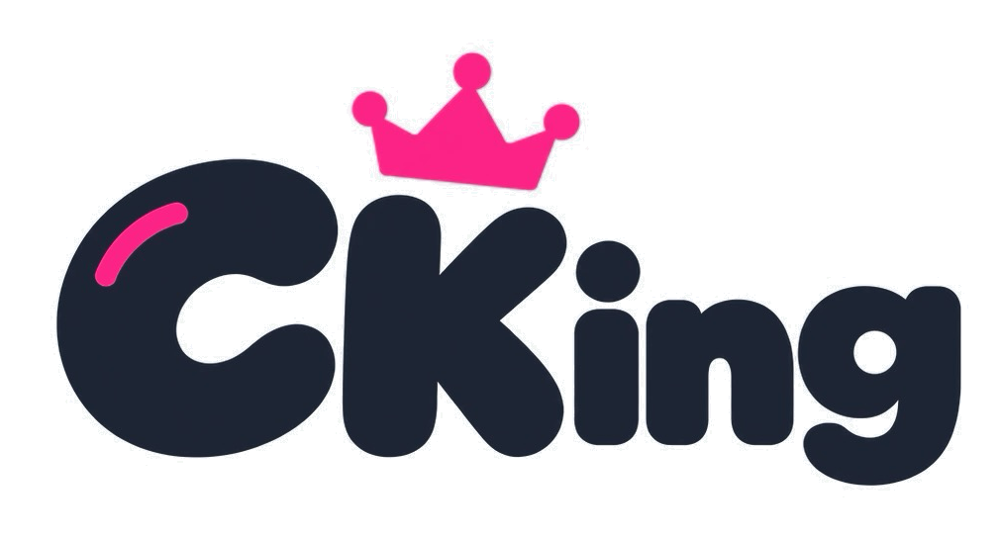
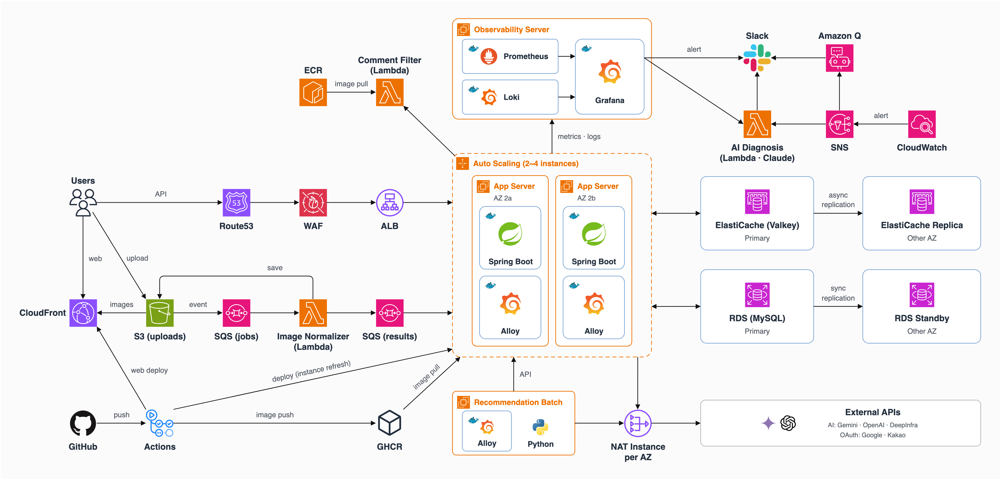
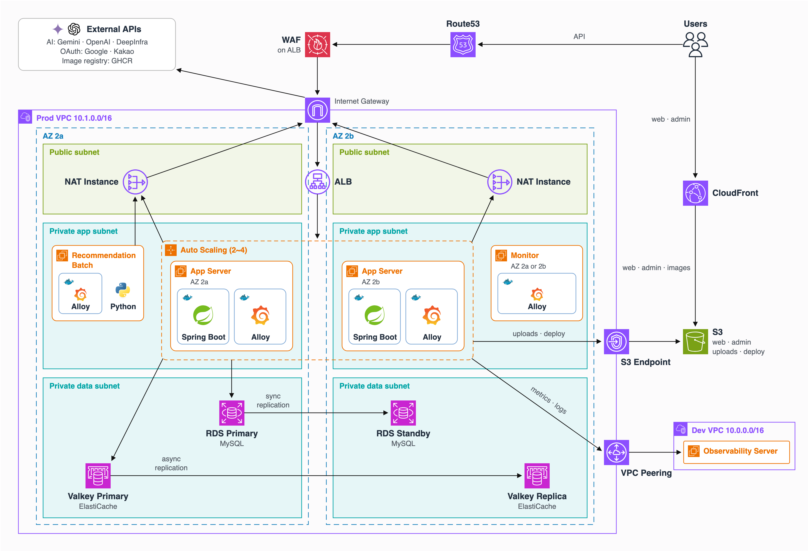
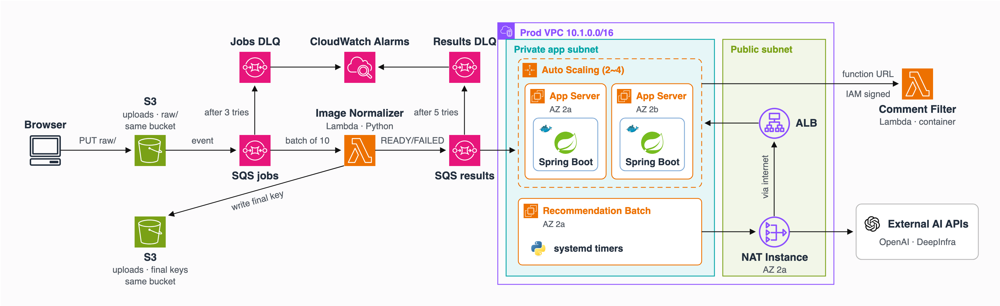
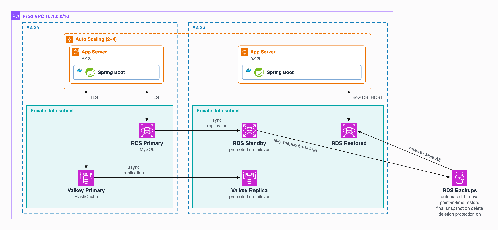
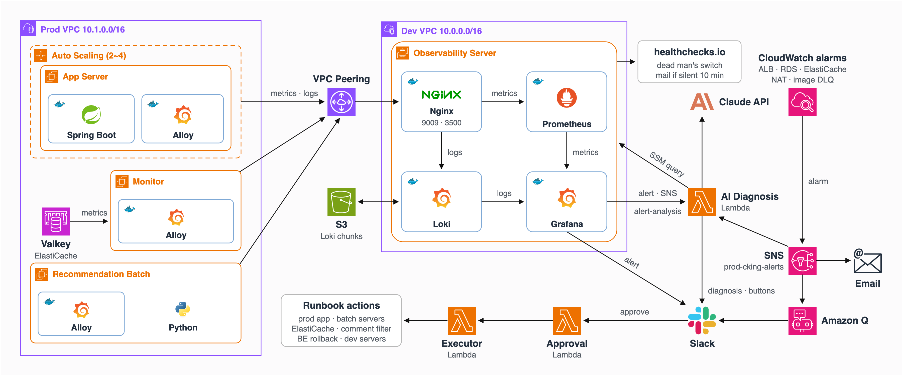
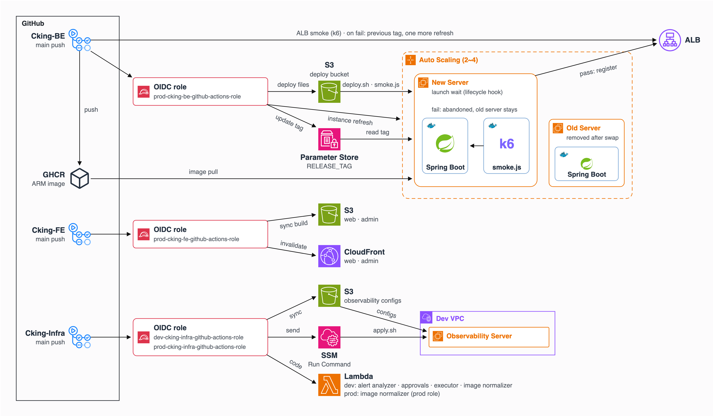
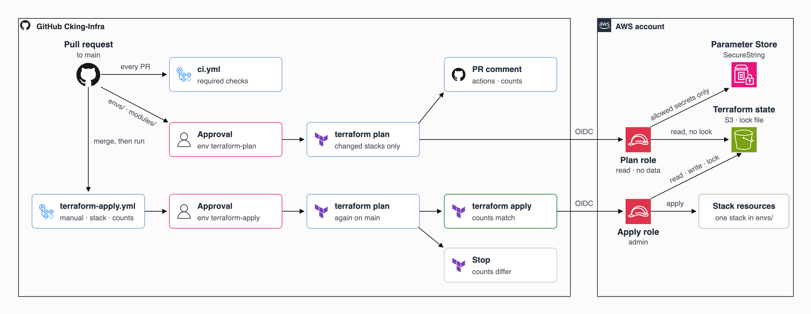

  

  <h3>크리에이터와 팬을 잇는 팬 참여형 이벤트 플랫폼</h3>
  
Cking의 AWS 인프라 코드(Terraform)와 운영 문서 저장소입니다.

  

  

  

  

  
서비스는 종료되었습니다. 시연은 DEMO 영상에서 볼 수 있습니다.

## 전체 구성

| 환경 | 구성 | 문서 |
|---|---|---|
| 운영 | 위 그림. 개발과 분리된 VPC, 앱 서버 2\~4대, Valkey·MySQL 다중 AZ | [설계서 2절](docs/design.md#2-환경) · [구축 절차](docs/setup.md#운영-환경) |
| 개발 | 앱 서버 1대(앱·Redis 컨테이너), MySQL 단일 AZ. 관측 서버와 AI 진단 Lambda가 여기 있고 운영도 함께 쓴다 | [설계서 2절](docs/design.md#2-환경) · [구축 절차](docs/setup.md#개발-환경) |
| 부하 테스트 | 개발과 같은 사양을 측정 때만 만들고 지운다 | [실행 자동화](loadtest/README.md) · [측정 결과](docs/loadtest.md) |

## 영역별 구성

아래는 운영 환경 기준이다.

### 네트워크·요청

- 운영 VPC는 AZ 2a·2b마다 퍼블릭, 프라이빗 앱, 프라이빗 데이터 서브넷을 둔다. API는 Route53 → ALB(퍼블릭, WAF 규칙 적용) → 앱 서버(프라이빗 앱, Auto Scaling 2\~4대) → RDS·Valkey(프라이빗 데이터)로 간다
- 앱 서브넷의 바깥 요청은 같은 AZ의 NAT 인스턴스로, S3 요청은 게이트웨이 엔드포인트로 나간다. 관측 서버가 있는 개발 VPC와는 피어링으로 잇는다
- 웹·관리자 화면과 프로필 이미지는 CloudFront가 S3에서 내보낸다

| 구분 | 위치 | 내용 |
|---|---|---|
| 코드 | `envs/prod/`의 `network.tf`, `nat.tf`, `peering.tf` | VPC·서브넷·경로와 S3 엔드포인트, AZ별 NAT 인스턴스, 개발 VPC와의 피어링 |
| 코드 | `envs/prod/`의 `alb.tf`, `cdn.tf`, `modules/api-waf/` | ALB, CloudFront(웹·관리자·이미지), ALB에 붙는 WAF 규칙 |
| 설계서 | [3절 네트워크](docs/design.md#3-네트워크) | 서브넷 배치, NAT를 AZ마다 인스턴스로 둔 이유 |
| 설계서 | [7절 보안](docs/design.md#7-보안) | WAF, 보안 그룹, 오픈 전 접근 제한 |
| 런북 | [운영 NAT 인스턴스 경보](docs/runbooks/prod-nat.md) | NAT 경보 대응, NAT 방식(인스턴스·게이트웨이) 바꾸기 |
| 런북 | [운영 ALB 경보](docs/runbooks/prod-alb.md) | 정상 서버 없음·부족, 5xx 경보 대응 |

### 비동기 작업

- 이미지: 브라우저가 앱에서 받은 사전 서명 주소로 S3 `raw/`에 바로 올린다. S3 이벤트 → SQS 작업 큐 → 정규화 Lambda(배치 10, 동시 5) → 최종 경로에 저장 → SQS 결과 큐 → 앱이 READY·FAILED를 기록한다. 형식·크기가 맞지 않으면 FAILED 결과로 끝나고, 처리 오류는 큐마다 DLQ(작업 3회·결과 5회 실패)와 CloudWatch 경보로 잡는다. 원본은 1일 뒤 지운다
- 댓글 필터: 욕설·혐오·스팸·개인정보 노출 댓글을 걸러 낸다. 앱이 댓글을 저장한 뒤 댓글 필터 Lambda를 함수 URL(IAM 서명)로 부르고, 판정에 실패한 댓글은 PENDING으로 두고 다시 판정한다
- 추천 배치: 크리에이터 소개글로 맞춤 추천 후보를 만든다. 추천 배치 서버(2a, 1대)의 systemd 타이머(1분마다·매일 03:00)가 NAT를 거쳐 외부 AI API(OpenAI·DeepInfra)를 부른다. 작업과 결과는 같은 NAT에서 ALB를 거쳐 앱 내부 API로 주고받는다

| 구분 | 위치 | 내용 |
|---|---|---|
| 코드 | `envs/prod/image_pipeline.tf`, `image-normalizer/` | 작업·결과 큐와 DLQ, S3 이벤트 연결, 정규화 Lambda 코드 |
| 코드 | `envs/prod/comment_filter.tf` | 댓글 필터 Lambda와 함수 URL |
| 코드 | `envs/prod/recommendation.tf` | 추천 배치 서버와 상태 디스크 |
| 설계서 | [6절 이미지 업로드 파이프라인](docs/design.md#6-이미지-업로드-파이프라인) | 앱 안 처리에서 분리한 이유, 처리 한계 |
| 런북 | [이미지 파이프라인 DLQ 쌓임](docs/runbooks/image-pipeline-dlq.md) | 처리에 실패한 메시지가 DLQ에 쌓였을 때 |
| 런북 | [댓글 필터 차단·해제](docs/runbooks/comment-filter.md) | 필터 판정이 잘못되거나 호출을 멈춰야 할 때 |
| 런북 | [추천 배치 서버](docs/runbooks/recommendation-batch.md) | 서버를 띄우거나 값을 바꿀 때, 작업자가 돌지 않을 때 |

### 장애 조치·복원

- RDS MySQL은 다른 AZ에 대기 DB를 둔 다중 AZ(동기 복제)이고, ElastiCache Valkey는 주 2a·복제 2b 2노드(비동기 복제, 자동 장애 조치)다. 둘 다 프라이빗 데이터 서브넷에 있고 앱과는 TLS로만 연결한다
- AZ·하드웨어 장애 때는 대기 DB·복제 노드가 주 노드로 승격된다. 앱은 엔드포인트 이름(`DB_HOST`, `REDIS_HOST`)으로 붙어 설정을 바꾸지 않는다. 장애 조치 중 실패 요청과 회복 시간은 [게임 데이 문서](docs/gameday.md)에 있다
- 잘못된 쓰기·삭제는 자동 백업(14일, 시점 복구)으로 새 RDS를 띄우고 `DB_HOST`를 바꿔 되돌린다. 훈련에서 장애 선언부터 복원 DB로 서비스까지 27분 14초, 잃은 데이터는 약 6분(6분 5초) 분량이었다. 삭제 방지를 켜 두고, 지울 때는 마지막 스냅샷을 남긴다
- Valkey는 스냅샷(7일)을 두지만 복원에 쓰지 않는다. 복원한 DB와 맞추려고 잔액 키만 지워 DB에서 다시 채운다

| 구분 | 위치 | 내용 |
|---|---|---|
| 코드 | `envs/prod/`의 `database.tf`, `cache.tf` | RDS MySQL 다중 AZ와 백업, ElastiCache Valkey 복제 그룹 |
| 설계서 | [5절 데이터](docs/design.md#5-데이터) | DB·캐시 구성을 고른 이유, 백업·복구 훈련 결과 |
| 런북 | [운영 RDS 경보](docs/runbooks/prod-rds.md) | RDS 경보 대응 |
| 런북 | [운영 ElastiCache 경보](docs/runbooks/prod-elasticache.md) | Valkey 경보 대응 |
| 런북 | [운영 DB 복원](docs/runbooks/prod-db-restore.md) | 잘못된 쓰기·삭제를 백업 시점으로 되돌리는 절차 |

### 관측·경보

- 운영 앱·감시용·추천 배치 서버의 수집기(Alloy)가 지표·로그를 VPC 피어링을 거쳐 개발 VPC의 관측 서버로 보낸다. 관측 서버에서는 Nginx가 수집 입구다. 9009로 온 지표는 Prometheus로, 3500으로 온 로그는 Loki로만 넘긴다. ElastiCache 지표는 감시용 서버가 모으고, Loki 청크는 S3에 둔다
- Grafana 경보는 Slack으로 간다. 운영 AWS 서비스 경보(ALB·RDS·ElastiCache·NAT·이미지 DLQ, 서버 띄우기 실패, GuardDuty)는 CloudWatch·EventBridge → SNS → Amazon Q(Slack 연동, 옛 AWS Chatbot)로 Slack에, 메일로도 간다
- 두 경보 모두 AI 진단 Lambda가 받아 런북대로 읽기 전용 조회를 하고 판단을 Slack에 남긴다. Prometheus·Loki 조회는 관측 서버의 고정 SSM 문서로만 한다. 정해진 조치만 승인자가 버튼으로 실행하고, 나머지는 런북대로 사람이 한다
- 관측 서버는 컨테이너 재시작, EC2 상태 검사 자동 복구, 데드맨(healthchecks.io) 세 겹으로 감시한다. 관측 서버가 멈추면 데드맨이 알린다

| 구분 | 위치 | 내용 |
|---|---|---|
| 코드 | `observability/` | 관측 서버 설정(Nginx, Prometheus, Loki, Grafana 대시보드·경보) |
| 코드 | `app-agent/` | 서버 수집기(Alloy) 설정 |
| 코드 | `alert-analyzer/` | AI 진단·승인·실행 Lambda 코드 |
| 코드 | `envs/dev/`의 `observability.tf`, `alert_analyzer.tf`, `alert_actions.tf` | 관측 서버, AI 진단용 SNS 주제와 조회 SSM 문서, 승인 버튼과 실행 SSM 문서 |
| 코드 | `envs/prod/`의 `alarms.tf`, `alert_analyzer.tf`, `monitor.tf` | 운영 CloudWatch 경보와 SNS, AI 진단 구독, 감시용 서버 |
| 설계서 | [9절 관측](docs/design.md#9-관측) | 수집·저장·화면·경보·진단 구성 |
| 런북 | [런북 목록](docs/runbooks/README.md) | 경보별 대응 절차와 운영 절차 |

### 배포

- [Cking-BE](https://github.com/URECA-Cking/Cking-BE): main push 뒤 ARM 이미지를 GHCR에 올리고, 배포 파일을 S3에 올린 뒤 배포 태그(Parameter Store `/cking/prod/RELEASE_TAG`)를 바꾸고 앱 서버 그룹을 교체한다(instance refresh). 새 서버는 시작 대기(lifecycle hook) 중에 그 태그로 앱을 띄우고 k6 스모크로 자기 자신을 검사해 통과해야 ALB에 붙는다. 실패하면 버려지고 옛 서버가 남는다. 교체 뒤 ALB 경로 스모크가 실패하면 이전 태그로 한 번 다시 교체한다
- [Cking-FE](https://github.com/URECA-Cking/Cking-FE): web·admin 빌드 결과를 S3에 동기화하고 CloudFront 캐시를 무효화한다
- Cking-Infra: main 머지 뒤 관측 설정은 S3에 올리고 SSM으로 관측 서버의 `apply.sh`를 실행하며, Lambda는 함수마다 새 코드를 배포한다. 운영 서버(앱·감시용·추천 배치)의 수집기 설정은 부팅 때 같은 버킷의 `app-agent/` 경로에서 받는다
- 배포 권한은 저장소마다 GitHub OIDC 역할로 나누고, 각 역할은 해당 저장소의 main 브랜치에서만 쓸 수 있다. Cking-Infra의 운영 Lambda 배포만 운영 역할을 따로 쓴다. 댓글 필터·추천 배치 저장소도 각자의 OIDC 역할로 배포한다

| 구분 | 위치 | 내용 |
|---|---|---|
| 코드 | `envs/prod/app.tf`, `envs/prod/templates/app-init.sh` | 앱 서버 그룹과 교체 설정, 새 서버가 앱을 띄우고 스모크로 자기 검사하는 부팅 스크립트 |
| 코드 | `envs/prod/deploy_roles.tf`, `envs/prod-base/iam.tf` | 저장소별 배포 OIDC 역할, 운영 서버 IAM 역할 |
| 코드 | `.github/workflows/deploy-*.yml` | 관측 설정·수집기·Lambda 배포 워크플로 |
| 설계서 | [8절 배포](docs/design.md#8-배포) | 대상별 배포 방식, 연속 머지와 서버 교체 중 처리 |
| 런북 | [배포 실패](docs/runbooks/deploy-failed.md) | 배포 워크플로가 실패했을 때 |

### 인프라 변경

- PR이 `envs/`·`modules/`를 바꾸면 Environment `terraform-plan` 승인 뒤 바뀐 스택만 plan해 리소스 주소·동작과 추가·변경·삭제 개수를 PR 댓글로 남긴다. 머지 뒤 main에서 `terraform-apply.yml`을 수동 실행하고(스택, 댓글의 개수) Environment `terraform-apply` 승인을 받으면, 다시 plan해 개수가 같을 때만 적용한다
- 두 워크플로는 GitHub OIDC로 역할을 받고, 역할의 신뢰 조건은 Environment로 묶는다. plan 역할은 읽기 전용(데이터 읽기 거부, plan이 읽는 비밀값만 복호화)이고 apply 역할은 관리자 권한이다
- 상태는 S3 버킷 하나(버전 관리)에 스택마다 `<스택>/terraform.tfstate`로 두고, 잠금은 S3 잠금 파일을 쓴다. 비밀값은 Parameter Store에 두고 코드에는 경로만 쓴다. 상태 파일·비밀값은 커밋하지 않는다
- PR마다 CI 필수 검사(fmt·tflint·validate, 설정 검증, shellcheck·actionlint, pytest, checkov·gitleaks)를 통과해야 머지한다. 로컬 apply는 [구축 문서](docs/setup.md#바꿀-때)에 적은 경우에만 한다

| 구분 | 위치 | 내용 |
|---|---|---|
| 코드 | `.github/workflows/terraform-plan.yml`, `terraform-apply.yml` | PR plan 댓글, 승인 뒤 적용 |
| 코드 | `.github/workflows/ci.yml` | PR 필수 검사 |
| 코드 | `envs/ci/` | plan·apply용 OIDC 역할 |
| 설계서 | [10절 IaC와 CI](docs/design.md#10-iac와-ci) | 적용 절차, 공개 저장소 대응, PR 검사 목록 |

## 주요 결정과 검증

| 결정 | 대안 | 근거 |
|---|---|---|
| 앱 서버 c6g.large | t4g.small | 정각 CPU steal 최대 79% → 0%, 정각 응모 API 최대 1,506ms → 253ms([loadtest.md 3.3절](docs/loadtest.md#33-3차-운영-환경)) |
| 이미지를 S3 직접 업로드 + Lambda 정규화 | 앱 안에서 정규화 | 앱 메모리 초과 재시작과 업로드와 무관한 조회 502 → 0, 초당 16건까지([loadtest.md 3.5절](docs/loadtest.md#35-이미지-업로드)) |
| AZ마다 NAT 인스턴스 | NAT Gateway | 월 \$86 → 약 \$17, 응답 시간 차이 없음([설계서 3절](docs/design.md#3-네트워크)) |
| 관측 자체 운영(Prometheus·Loki·Grafana) | AMP + AMG, CloudWatch | 월 약 \$22 vs \$44\~79 vs 약 \$732([설계서 12절](docs/design.md#12-주요-결정과-대안)) |

나머지 결정과 대안은 [설계서 12절](docs/design.md#12-주요-결정과-대안)에 있다.

## 저장소 구조

`envs/` 아래 폴더 하나가 스택(상태 파일 하나)이다.

| 경로 | 내용 |
|---|---|
| `envs/account` | 계정에 하나인 리소스(Route53 영역, 인증서, GitHub OIDC, 예산) |
| `envs/ci` | Terraform plan·apply를 GitHub Actions로 하는 역할 |
| `envs/security` | 계정 보안 기준선(CloudTrail, GuardDuty, Config, Security Hub) |
| `envs/dev` | 개발 환경. 관측 서버·AI 진단·댓글 필터 ECR처럼 운영과 함께 쓰는 리소스도 여기 있다 |
| `envs/prod`, `envs/prod-base` | 운영 환경과 운영 IAM(운영을 지워도 남긴다) |
| `envs/loadtest`, `envs/loadtest-base` | 부하 테스트 환경과 그 IAM·결과 버킷(테스트 환경을 지워도 남긴다) |
| `modules/` | 공용 모듈(API WAF, k6 서버) |
| `observability/` | 관측 서버 설정(Prometheus, Loki, Grafana 대시보드·경보) |
| `app-agent/` | 서버 수집기(Alloy) 설정 |
| `alert-analyzer/`, `image-normalizer/` | AI 진단 Lambda, 이미지 정규화 Lambda 코드 |
| `loadtest/` | 부하 테스트 실행 자동화 |
| `bootstrap/` | Terraform보다 먼저 만든 상태 버킷 기록 |
| `.github/workflows/` | PR 검사, Terraform plan·apply, 관측 설정·수집기·Lambda 배포 |
| `docs/` | 설계서, 구축 문서, 측정 기록, 런북 |

스택마다 상태 파일은 상태 버킷의 `<스택 이름>/terraform.tfstate`에 있고, Terraform이 만든 리소스에는 `ManagedBy = terraform` 태그가 붙는다.

## 구축

상태 버킷(`bootstrap/`, 콘솔)을 먼저 만든다. 뒤 스택이 앞 스택의 리소스를 이름·태그로 조회하므로 스택은 `envs/account` → `envs/ci` → `envs/dev` → `envs/prod-base` → `envs/prod` → `envs/security` 순서로 만든다. 부하 테스트는 `envs/loadtest-base`를 만든 뒤 `loadtest/lt.sh`로 띄우고 지운다.

요구 사항: Terraform 1.16 이상, AWS CLI, Session Manager 플러그인. 단계별 절차는 [구축 문서](docs/setup.md)에 있다.

## 문서

| 문서 | 내용 |
|---|---|
| [docs/design.md](docs/design.md) | 설계서: 구성, 환경, 네트워크, 컴퓨팅, 데이터, 이미지 업로드 파이프라인, 보안, 배포, 관측, IaC와 CI, 비용, 결정과 대안 |
| [docs/setup.md](docs/setup.md) | 구축 문서: 바꿀 때의 규칙, 처음 구축하는 순서, 환경별 적용 절차, 지울 때 |
| [docs/loadtest.md](docs/loadtest.md) | 부하 테스트 SLO와 차수별 결과(운영에서 응모 API 초당 578건까지 p95 44ms 이하) |
| [docs/gameday.md](docs/gameday.md) | 장애 주입 게임 데이와 장애 조치 재측정 |
| [docs/runbooks/](docs/runbooks/README.md) | 경보별 대응 절차와 운영 절차(NAT 방식 전환, DB 복원 등) |
| [loadtest/README.md](loadtest/README.md) | 부하 테스트 실행 자동화 |
